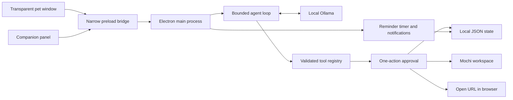

# Architecture

Mochi is one Electron application and one separately managed local Ollama server. The core is plain CommonJS JavaScript with Node standard-library dependencies. No web server, bundler, database daemon, or framework is required for the app.

## Runtime boundaries

- Both windows use sandboxing, context isolation, no Node integration, a restrictive Content Security Policy, blocked navigation, and no new windows.
- IPC handlers validate the sending window and its exact local URL. The pet can only read state and toggle the companion panel.
- Only the main process connects to Ollama. Endpoints must be loopback origins; credentials, paths, redirects, and cloud-named models are rejected.
- Every turn has an abort controller. A turn permits at most eight inference steps and six tool calls per step. Inference requests time out after three minutes. Approval expires after two minutes and defaults to denial.
- Only one turn or manual tool action can run at a time. Stop aborts inference and pending approval; already completed actions are not rolled back.
- The UI renders model responses and tool content as text, never as HTML.

## Tools and memory

Each tool owns its schema, runtime argument validation, approval policy, and implementation. Unknown tools fail closed. Reads are limited to Mochi state and its dedicated workspace. Writes require a fresh, one-shot approval. Reminder timestamps are validated again after approval.

File tools accept simple top-level text filenames. Reads reject symlinks, non-regular files, and files over 32 KB. Writes use exclusive creation. This is an application boundary, not an OS sandbox against another process running as the same user.

Saved memories are explicit facts rather than automatically inferred personal profiles. The agent can retrieve them through `list_memories`; it does not automatically insert every memory into every request. Each turn includes up to 20 previous user/assistant messages. Intermediate tool results remain within that turn; completed tool activity is retained locally.

## Persistence and delivery

State writes replace a temporary JSON file by rename, with owner-only permissions on creation. Corrupt or unknown state is reported rather than silently overwritten. No cloud sync or encryption is provided in this prototype.

The reminder loop scans timestamps once per second while the app is running. It marks reminders delivered before emitting their notification, prioritizing no duplicate notifications. A crash between marking and displaying can lose that notification; transactional delivery and reconciliation are roadmap work. Due reminders are also checked on startup. The application does not wake sleeping devices.

The activity log records completed tools. Denied calls and failures are returned to the model but are not persisted as completed actions. A future task ledger should record each phase explicitly.

## Extending the agent

Add small tool definitions in `src/core/tools.cjs`, write behavior tests, and make side effects require approval. Do not expose renderer-controlled shell execution or raw Electron APIs. Browser automation should use its own profile and a constrained executor. MCP integration should have a tool allowlist and capability-specific permissions.

Sources: [Electron security guide](https://www.electronjs.org/docs/latest/tutorial/security), [BrowserWindow API](https://www.electronjs.org/docs/latest/api/browser-window), [Ollama tool calling](https://docs.ollama.com/capabilities/tool-calling).
