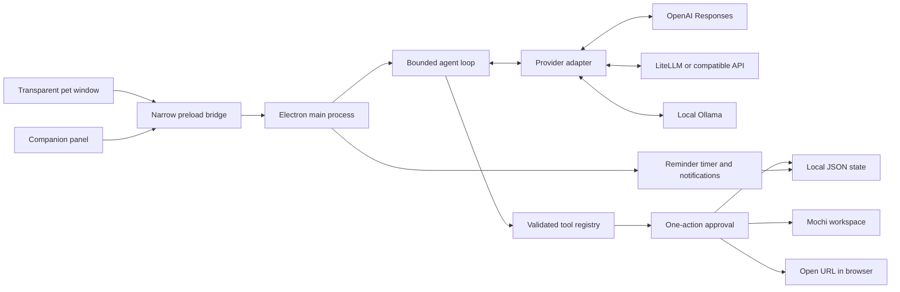

# Architecture

Mochi is one Electron application that calls a selected model provider. ChatGPT account sign-in is the default for new profiles; OpenAI API keys, LiteLLM, and Ollama are optional. The core is CommonJS JavaScript, Node standard libraries, and `jose` for signed identity-token verification. No separately hosted server, bundler, database daemon, or framework is required. A short-lived loopback HTTP listener handles OAuth callbacks during sign-in.

## Runtime boundaries

- Both windows use sandboxing, context isolation, no Node integration, a restrictive Content Security Policy, blocked navigation, and no new windows.
- IPC handlers validate the sending window and its exact local URL. The pet can read state, toggle the companion panel, and start/end dragging its own window. The main process reads cursor coordinates itself, bounds movement to a display's work area, and saves the position locally.
- Only the main process connects to model APIs. OpenAI uses its fixed HTTPS base URL; compatible endpoints allow HTTPS or loopback HTTP. Ollama remains loopback-only. Embedded URL credentials, queries, fragments, and redirects are rejected.
- API keys are scoped to the provider and exact base URL. They are encrypted using asynchronous OS-backed safeStorage and kept separately from state. The renderer can submit a replacement key but can only read its source/status afterward. Missing secure storage fails closed; environment credentials provide an alternative.
- ChatGPT OAuth runs only in the main process. A stable host ID and separate client/account registrations live in an encrypted vault; the renderer sees only labels, opaque local IDs, and connection flags. Fresh state, nonce, and S256 PKCE bind each browser attempt. The callback validates state and client identity, persists issued registration before exchange, and verifies signed ID-token issuer/audience/expiry/nonce through OpenAI's JWKS. Returning identities must match the saved subject. OAuth credentials never go to LiteLLM or an API-key adapter.
- Token refreshes are serialized per registration. Rotated tokens and scopes are committed together with an atomic rename. Terminal refresh failures clear unusable tokens while retaining registration; transient errors retain the connection. Sign-out attempts revocation with a bounded retry, clears local tokens, and reports unconfirmed remote revocation. Browser authorization errors cannot echo token hints into the UI.
- Every turn has an abort controller. A turn permits at most eight inference steps and six tool calls per step. Inference requests time out after three minutes. Approval expires after two minutes and defaults to denial.
- Only one turn or manual tool action can run at a time. Stop aborts inference and pending approval; already completed actions are not rolled back.
- The UI renders model responses and tool content as text, never as HTML.

## Provider adapters

The agent uses a common message and tool-call format. API-key OpenAI and LiteLLM Responses requests flatten tool schemas and correlate each `function_call_output` by `call_id`. ChatGPT plan requests use a `mochi` tool namespace, `instructions` for the system prompt, `store: false`, `stream: true`, and complete history in an input array. They omit unsupported output-token caps and persistent response IDs. The streaming adapter processes SSE through `response.completed` before returning text or tool proposals. Deltas alone never authorize tools; interrupted, failed, malformed, or incomplete streams fail closed. Output is currently displayed after completion, rather than token-by-token.

Full response output, including encrypted reasoning and assistant phase, is replayed within the current turn. Chat Completions retains provider message fields and returns results with `tool_call_id`. Ollama keeps its native message format. ChatGPT model discovery uses the signed-in account's `models` catalog and preserves visible model ordering/display labels; API-key mode uses the API `data` catalog. No provider or billing fallback is automatic.

Incomplete responses and malformed JSON arguments fail before any proposed tools execute. Connection checks fetch the model list without generating a response. They establish connectivity and model visibility, not inference quality or full tool compatibility. Hosted model requests transmit chat context and tool outputs to the selected provider; local state storage does not imply local inference.

## Tools and memory

Each tool owns its schema, runtime argument validation, approval policy, and implementation. Unknown tools fail closed. Reads are limited to Mochi state and its dedicated workspace. Writes require a fresh, one-shot approval. Reminder timestamps are validated again after approval.

File tools accept simple top-level text filenames. Reads reject symlinks, non-regular files, and files over 32 KB. Writes use exclusive creation. This is an application boundary, not an OS sandbox against another process running as the same user.

Saved memories are explicit facts rather than automatically inferred personal profiles. The agent can retrieve them through `list_memories`; it does not automatically insert every memory into every request. Each turn includes up to 20 previous user/assistant messages. Intermediate tool results remain within that turn; completed tool activity is retained locally.

## Persistence and delivery

State writes replace a temporary JSON file by rename, with owner-only permissions on creation. Corrupt or unknown state is reported rather than silently overwritten. Chat, memory, and activity state are not encrypted or synced. API credentials use `credentials.json`; ChatGPT credentials use the separate encrypted `chatgpt-auth.json`, with owner-only permissions. All are outside the repository and ignored by Git.

The reminder loop scans timestamps once per second while the app is running. It marks reminders delivered before emitting their notification, prioritizing no duplicate notifications. A crash between marking and displaying can lose that notification; transactional delivery and reconciliation are roadmap work. Due reminders are also checked on startup. The application does not wake sleeping devices.

The activity log records completed tools. Denied calls and failures are returned to the model but are not persisted as completed actions. A future task ledger should record each phase explicitly.

## Extending the agent

Add small tool definitions in `src/core/tools.cjs`, write behavior tests, and make side effects require approval. Do not expose renderer-controlled shell execution or raw Electron APIs. Browser automation should use its own profile and a constrained executor. MCP integration should have a tool allowlist and capability-specific permissions.

Sources: [Electron security guide](https://www.electronjs.org/docs/latest/tutorial/security), [BrowserWindow API](https://www.electronjs.org/docs/latest/api/browser-window), [Ollama tool calling](https://docs.ollama.com/capabilities/tool-calling), [OpenAI function calling](https://developers.openai.com/api/docs/guides/function-calling), [LiteLLM Responses](https://docs.litellm.ai/docs/response_api), [Electron safeStorage](https://www.electronjs.org/docs/latest/api/safe-storage).
